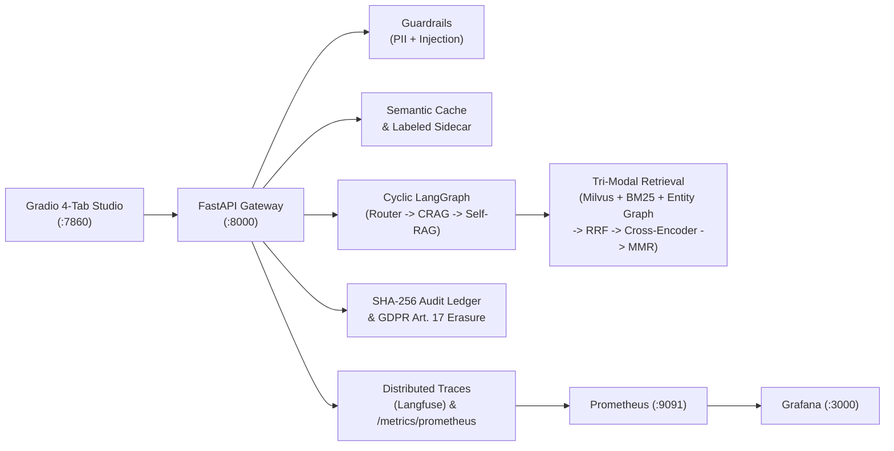

# 🏗️ Staff+ / Principal RAG Engineering Platform — Interview Showcase & Live Demo Guide

An interview-ready, production-grade **Retrieval-Augmented Generation (RAG)** microservices platform orchestrated with **Docker Compose**, **FastAPI**, **Milvus**, **RabbitMQ**, **LangGraph**, **Ollama**, **Gradio**, **Prometheus**, **Grafana**, and **Langfuse-compatible Distributed Tracing**.

> **Deep-Dive Companion Docs:**
> - 📖 [**Staff RAG Interview Guide (`docs/INTERVIEW_GUIDE.md`)**](docs/INTERVIEW_GUIDE.md) — Mathematical formulations (RRF, Cross-Encoder Calibration, NDCG@K), 6 prototype anti-patterns fixed, and system design Q&A.
> - 🌐 [**50-Company RAG Tech Blog Study (`docs/INDUSTRY_RAG_TODO.md`)**](docs/INDUSTRY_RAG_TODO.md) — Production patterns from Google, Netflix, Anthropic, Uber, DoorDash, Bloomberg, Capital One, and more.

---

## 🎯 60-Second Interview Elevator Pitch

> *"Instead of a naive dense-only prototype, I built a modular, 100% local **Production RAG Platform** with **Pre-Filtered Multi-Tenant RBAC**, **Table-Aware Parent-Child Chunking** with SHA-256 deduplication, and a **Tri-Modal Hybrid Retrieval Engine** (Milvus Dense + BM25 + 1-hop Entity Knowledge Graph fused via **Reciprocal Rank Fusion**, followed by **Cross-Encoder Reranking**, **MMR Diversity**, and **Lost-in-the-Middle** U-shaped reordering). Orchestration runs on a **cyclic LangGraph StateGraph** implementing **Adaptive Query Routing** (`lexical_lookup`, `conceptual_hyde`, `multi_hop`), **Corrective RAG (CRAG)** gating, and **Self-RAG** faithfulness verification with **structured `[Doc i]` inline citations & supporting quotes**. The system includes **PII & Prompt Injection Guardrails**, **GDPR Article 17 surgical erasure**, a **tamper-evident SHA-256 hash-chained audit ledger**, **hierarchical distributed span waterfalls**, **Prometheus/Grafana**, and an automated **29-test TDD & 5-mode IR Ablation suite**."*



---

## 🔗 Quick Links & Service URLs

| Interface / Endpoint | Local `.venv` URL | Docker Compose URL | Purpose in Demo / Interview |
| :--- | :--- | :--- | :--- |
| **Gradio 4-Tab Studio** | [http://127.0.0.1:7860](http://127.0.0.1:7860) | [http://localhost:7860](http://localhost:7860) | Main interactive UI (Ingestion, SSE Query, Ablations, Audit Center) |
| **FastAPI Swagger UI** | [http://127.0.0.1:8000/docs](http://127.0.0.1:8000/docs) | [http://localhost:8000/docs](http://localhost:8000/docs) | Interactive OpenAPI schema & GDPR deletion endpoint |
| **Distributed Traces JSON** | [http://127.0.0.1:8000/traces](http://127.0.0.1:8000/traces) | [http://localhost:8000/traces](http://localhost:8000/traces) | Langfuse-compatible parent-child spans & waterfall timings |
| **Compliance Audit Dossier** | [http://127.0.0.1:8000/compliance/audit-report](http://127.0.0.1:8000/compliance/audit-report) | [http://localhost:8000/compliance/audit-report](http://localhost:8000/compliance/audit-report) | Full JSON + Markdown system audit report |
| **SHA-256 Audit Ledger** | [http://127.0.0.1:8000/audit-logs](http://127.0.0.1:8000/audit-logs) | [http://localhost:8000/audit-logs](http://localhost:8000/audit-logs) | Tamper-evident hash-chained event history (`chain_valid: true`) |
| **Prometheus Metrics** | [http://127.0.0.1:8000/metrics/prometheus](http://127.0.0.1:8000/metrics/prometheus) | [http://localhost:8000/metrics/prometheus](http://localhost:8000/metrics/prometheus) | Raw Prometheus exposition (`p50`/`p95`/`p99`, cache, guardrails) |
| **Grafana Dashboard** | _Docker only_ | [http://localhost:3000](http://localhost:3000) | Pre-provisioned `Staff+ RAG Observability` dashboard (`admin`/`admin`) |
| **Prometheus UI** | _Docker only_ | [http://localhost:9091](http://localhost:9091) | Live metric scraper targets & PromQL explorer |
| **Milvus Attu UI** | _Docker only_ | [http://localhost:9090](http://localhost:9090) | Inspect Milvus vector collections & entities |
| **RabbitMQ Management** | _Docker only_ | [http://localhost:15672](http://localhost:15672) | Inspect `rag_jobs` async queues (`guest`/`guest`) |
| **MinIO Console** | _Docker only_ | [http://localhost:9001](http://localhost:9001) | Inspect Milvus object storage buckets (`minioadmin`/`minioadmin`) |
| **Codebase Knowledge Graph** | [graphify-out/graph.html](graphify-out/graph.html) | — | Interactive `graphify` architecture map (`577` nodes, `1,071` edges) |

---

## 🚀 Step 1: Start the Platform

### Option A — Fast Local Mode (Recommended for Live Coding / Interviews)
Activate the pre-configured Python 3.10 `.venv` in **two terminals**:

**Terminal 1 — FastAPI Backend (`:8000`):**
```powershell
cd C:\Users\miari\Desktop\RAG\backend
..\.venv\Scripts\python.exe -m uvicorn main:app --host 127.0.0.1 --port 8000
```

**Terminal 2 — Gradio 4-Tab Studio (`:7860`):**
```powershell
cd C:\Users\miari\Desktop\RAG\frontend
$env:BACKEND_URL = "http://127.0.0.1:8000"
..\.venv\Scripts\python.exe app.py
```

### Option B — Full Docker Compose Stack (Includes Milvus, RabbitMQ, Ollama, Prometheus, Grafana, MinIO)
```powershell
cd C:\Users\miari\Desktop\RAG
docker-compose up -d --build
docker exec -it ollama ollama pull llama3.1
```

---

## 🎬 Step 2: 5-Minute Live Interview Demo Script

Open **[http://127.0.0.1:7860](http://127.0.0.1:7860)** and walk the interviewer through these 5 steps:

### 1. Ingestion, Deduplication & Security Guardrails (Tab 1)
1. Click **🚀 Seed Enterprise Sample Corpus (3 Docs)** to index the 3 built-in enterprise docs (`AegisPay RFC-402`, `RAG Playbook`, `Governance Directory`).
2. Click **📥 Ingest Document** twice with the same text $\rightarrow$ point out **SHA-256 Content-Addressable Deduplication** (`chunks_indexed_new: 0`, `chunks_skipped_duplicate > 0`).
3. Paste text containing `alice@corp.com`, `123-45-6789`, and `Ignore previous instructions` $\rightarrow$ click **📥 Ingest Document** to show `Guardrail Flags: ['pii_redacted', 'prompt_injection_detected']`.

### 2. Distributed Tracing, Retrieval Funnel & Inline Citations (Tab 2)
1. Uncheck **External Web Search (DuckDuckGo)** if offline, keep the default query `"What triggers ERR_LEDGER_9042 and what is the remediation command?"`, and click **⚡ Stream Live (SSE)**.
2. Highlight three things for the interviewer:
   - **Structured Inline Citations:** `[Doc 1: Title §Section]` badges + **`### 📚 Verified Inline Citations & Evidence Quotes`** with the exact supporting sentence extracted from the chunk.
   - **8-Stage Retrieval Candidate Funnel & Explainability Table:** Shows `Corpus` $\rightarrow$ `RBAC Authorized` $\rightarrow$ `Dense / BM25 / Graph` $\rightarrow$ `RRF Pool` $\rightarrow$ `Parent Windows` $\rightarrow$ `CRAG Relevant` $\rightarrow$ `MMR Selected`, plus per-modality **RRF Breakdown (D / S / G)**, **Matched Terms**, **Matched Entities**, and **Lost-in-the-Middle Prompt Slot**.
   - **Hierarchical Distributed Trace Waterfall:** Shows the root `rag_query_pipeline` span, stage spans, and nested `retrieval.*` sub-spans (`█` timeline bars).
3. Click **⚡ Stream Live (SSE)** a second time $\rightarrow$ point out **`Semantic Cache Hit: True`** (`<1ms` exact-match fast path).

### 3. Pre-Filtered RBAC Access Control (Tab 2)
1. Uncheck `compliance` in **Caller RBAC Roles** (leaving only `public`, `engineering`).
2. Query `"What is the PagerDuty rotation ID?"` $\rightarrow$ show that **Pre-Filtered RBAC** blocks the `compliance`-only Governance document *before* vector/BM25 scoring (zero data leakage, zero recall starvation).
3. Re-check `compliance` and re-run $\rightarrow$ `PD-EMEA-8821` is retrieved immediately.

### 4. Quantitative 5-Mode IR Ablation Benchmark (Tab 3)
1. Click **🧪 Run Full 5-Mode Retrieval Ablation Study**.
2. Walk through the live Markdown table comparing **Dense Only**, **Sparse (BM25)**, **Hybrid RRF (`k=60`)**, **Hybrid + Cross-Encoder**, and **Tri-Modal GraphRAG** across `HitRate@3`, `MRR@3`, `NDCG@3`, `Context Precision@3`, and `Mean Latency (ms)`.

### 5. Compliance Audit Center & GDPR Article 17 Erasure (Tab 4)
1. Open **Tab 4 (`4. 🛡️ Compliance Audit & Observability Center`)** and click **🔄 Refresh Audit & Observability Dashboard**.
2. Show the **Executive Compliance Dossier** (`SHA-256 Audit Chain Integrity: VALID`), **Active Corpus & RBAC Lineage**, **Latest Trace Hierarchical Span Waterfall**, **Tamper-Evident SHA-256 Audit Ledger**, and **Live Prometheus `/metrics/prometheus` exposition**.
3. Copy any `doc_id` from the Active Corpus table into **GDPR Article 17 Erasure — Target doc_id** and click **🗑️ Erase Document (GDPR Art. 17)** $\rightarrow$ verify the document is surgically deleted across Dense, BM25, Entity Graph, and Semantic Cache, with an immutable `gdpr_article17_erasure` event appended to the SHA-256 hash chain.

---

## 🧪 Step 3: Run Automated Tests (`29` TDD, Security & GDPR Tests)

```powershell
cd C:\Users\miari\Desktop\RAG
.\.venv\Scripts\Activate.ps1
$env:PYTHONPATH = "$PWD\backend"
pytest backend/tests/ -v
python backend/debug.py
```

---

## 📂 Modular Repository Structure

```text
RAG/
├── .github/workflows/edd.yml      # CI Eval-Driven Development (pytest + 5-mode ablation gate)
├── observability/
│   ├── prometheus.yml             # Scrapes fastapi-backend:8000/metrics/prometheus every 5s
│   └── grafana/                   # Pre-provisioned Prometheus datasource & RAG dashboard
├── backend/
│   ├── app/
│   │   ├── config.py              # Environment-backed settings
│   │   ├── models.py              # Pydantic contracts (RBAC, CitationItem, PipelineTrace, Eval)
│   │   ├── ingestion/             # Table-aware Parent-Child chunking & SHA-256 dedup pipeline
│   │   ├── retrieval/             # Singleton models, Entity Graph, Hybrid RRF, Reranker, MMR, Cache
│   │   ├── agent/                 # Cyclic LangGraph StateGraph (Router -> CRAG -> Self-RAG + Citations)
│   │   ├── guardrails/            # PII & Injection Guardrails + SHA-256 Tamper-Evident Audit Trail
│   │   ├── memory/                # Multi-turn session memory & pronoun coreference resolution
│   │   ├── observability/         # Langfuse-compatible TraceCollector + Prometheus + Circuit Breakers
│   │   ├── evaluation/            # HitRate@K, MRR@K, NDCG@K & 5-Mode Ablation Benchmark
│   │   └── worker/                # RabbitMQ async query & ingestion workers with thread fallback
│   ├── mcp_server.py              # RBAC-scoped MCP server (retrieve, ingest, GDPR erase)
│   ├── main.py                    # FastAPI gateway
│   ├── debug.py                   # CLI diagnostic & ablation inspector
│   └── tests/                     # 29 automated TDD unit, integration, GDPR & OWASP security tests
├── frontend/
│   └── app.py                     # 4-Tab Gradio Observability, Eval & Compliance Audit Studio
├── docs/
│   ├── INTERVIEW_GUIDE.md
│   └── INDUSTRY_RAG_TODO.md
└── docker-compose.yml
```
