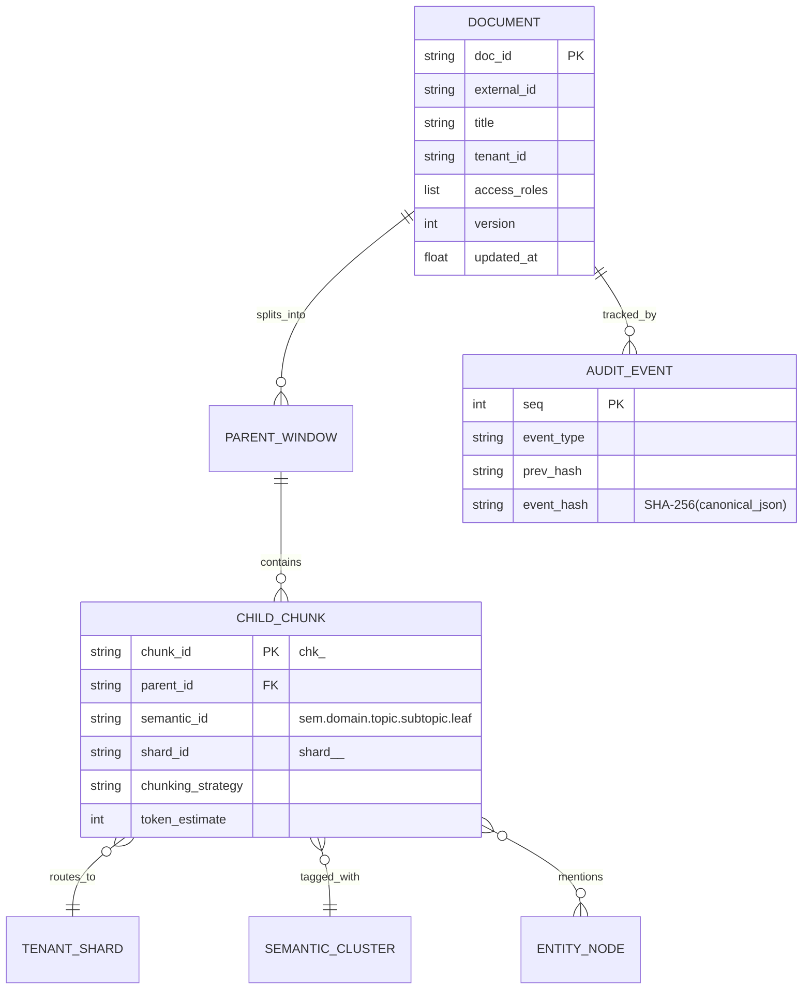

# Data Model, Storage Topology & Consistency Contracts

> **Spec-Kit Artifact:** `specs/001-staff-rag-platform/data-model.md`
> **Source of Truth:** `backend/app/models.py`, `backend/app/data/`, `backend/app/guardrails/audit.py`, `backend/app/agent/sql_tool.py`.

---

## 1. Database-per-Service Ownership Boundaries (`GET /data/boundaries`)

No service may read or mutate another service's private datastore directly (`shared_db_forbidden: True`). All cross-domain reads and writes flow through explicit APIs or Sagas:

| Owning Service | Private Datastore | Permitted Access Mode |
| :--- | :--- | :--- |
| `retrieval_service` | Milvus Vector DB + BM25 Lexical Index + Entity Knowledge Graph | API-only via `HybridRetrievalEngine`, `POST /ingest`, `POST /retrieve` |
| `sql_opsbot_service` | Operational SQLite (`service_inventory`, `active_incidents`) | Read-only `SELECT` API via `GET /inventory/sql-status` & `POST /inventory/sql-query` |
| `compliance_audit_service` | Append-only SHA-256 Hash-Chained Audit Ledger | Append-only via `TamperEvidentAuditLogger`, `GET /audit-logs`, `GET /compliance/audit-report` |
| `feedback_service` | User Feedback Satisfaction Store | API-only via `POST /feedback` & `GET /feedback` |

---

## 2. Chunk Lineage, Semantic IDs & Tenant Sharding

- **Content-Addressable Deduplication:** `chunk_id` is derived deterministically from normalized chunk text + tenant/document lineage, guaranteeing idempotent re-ingestion.
- **Spotify 4-Level Semantic IDs (`backend/app/retrieval/semantic_ids.py`):** Deterministic hierarchical cluster path (`sem.<l1>.<l2>.<l3>.<l4>`) enabling prefix-filtered retrieval via `semantic_id_prefix`.
- **Airbnb Tenant Partition Sharding (`backend/app/retrieval/hybrid.py`):** Deterministic tenant partition shard routing prunes foreign shards before vector/BM25 scoring.

---

## 3. Saga Pattern & CQRS Read Model (`backend/app/data/`)

### Ingestion & GDPR Erasure Sagas (`saga.py`)
1. **`execute_ingestion_saga` (`POST /saga/ingest`):** Coordinates ordered local transactions (`guardrail_sanitize` -> `index_vector_bm25_graph` -> `update_cqrs_projection` -> `append_audit_event`). If any step fails (or `inject_failure_step` is triggered for testing), `SagaOrchestrator` executes every completed step's compensating rollback in **strict reverse order** (removing partial vectors/chunks, reverting CQRS projection, logging `saga_compensated`).
2. **`execute_gdpr_erasure_saga`:** Coordinates multi-store surgical erasure across Dense, BM25, Entity Graph, Semantic Cache, and CQRS Read Model with full step-by-step compensation logs.

### CQRS Materialized Read Projection (`cqrs.py`, `GET /cqrs/read-model`)
- **Write Side (Commands):** `/ingest`, `/ingest/cdc`, `/ingest/pdf`, `/saga/ingest`, and `DELETE /documents/{doc_id}` mutate retrieval indices and call `cqrs_read_model.project_document_upserted(...)` or `remove_document(...)`.
- **Read Side (Queries):** `cqrs_read_model.snapshot()` serves an atomic, lock-free pre-materialized dictionary (`projection_version`, `total_documents`, `total_chunks`, `documents_by_tenant`, `documents_by_role`, `documents`) in $O(1)$ without scanning write indices.

---

## 4. Operational SQLite Schema (`backend/app/agent/sql_tool.py`)

Strictly read-only (`SELECT` / `WITH` only; `INSERT`, `UPDATE`, `DELETE`, `DROP`, `ALTER`, `ATTACH`, `PRAGMA`, and multi-statement `;` queries are blocked):
- **`service_inventory`**: `(service_name, region, status, active_nodes, p95_latency_ms, owner_team, updated_at)`
- **`active_incidents`**: `(incident_id, service_name, severity, error_code, summary, status, opened_at)`

---

## 5. SHA-256 Tamper-Evident Audit Record (`backend/app/guardrails/audit.py`)

Each event logged via `audit_logger.log_event(...)` passes `summary` through:
1. `guardrails.sanitize_text(summary, redact_pii=True, block_injections=True)`
2. `secrets_provider.redact_secrets(clean_summary)` (scrubs JWTs, API key patterns, and registered managed secrets)
3. Canonical JSON SHA-256 hashing linked to `prev_hash` (`0 * 64` genesis hash). `audit_logger.verify_chain()` recomputes all hashes end-to-end.

---

## 6. Pydantic v2 Schema Inventory (`backend/app/models.py` — 21 Models)

| Category | Models | Key Fields |
| :--- | :--- | :--- |
| **Ingestion & CDC** | `DocumentInput`, `CDCEventRequest`, `ChunkRecord` | `content`, `chunking_strategy`, `tenant_id`, `access_roles`, `version`, `updated_at`, `enable_contextual_enrichment`, `use_llm_contextualizer`, `enable_late_chunking`, `semantic_id`, `shard_id` |
| **Query & Retrieval** | `QueryInput`, `RetrieveDebugRequest`, `RetrievedChunk`, `CitationItem` | `retrieval_mode`, `top_k`, `session_id`, `max_retries`, `rrf_score`, `rrf_breakdown` (`dense`/`sparse`/`graph`), `calibrated_prob`, `freshness_boost`, `version_boost`, `prompt_position`, `supporting_quote` |
| **Structured & SQL** | `StructuredQueryRequest`, `StructuredQueryResponse`, `SQLQueryRequest` | `allowed_labels`, `classification_label`, `confidence`, `verifiable_rules_matched`, `citations`, `sql` |
| **Multi-Agent** | `OrchestrateRequest`, `SubagentResult`, `OrchestrateResponse` | `force_all_subagents`, `agent_id`, `tools_used`, `compliance_audit`, `trace_id`, `waterfall_markdown` |
| **Observability & Eval** | `PipelineTrace`, `EvaluationRequest`, `UserFeedbackRequest`, `PrewarmCacheRequest` | `trace_id`, `retrieval_funnel`, `stage_latencies_ms`, `faithfulness_score`, `enable_judge_eval`, `rating`, `queries` |
| **P4 Microservices** | `ServiceRegistrationRequest`, `ServiceTokenRequest`, `FeatureFlagUpdateRequest`, `ChaosConfigRequest` | `service_name`, `instance_id`, `ttl_sec`, `subject`, `audience`, `flag_name`, `rollout_percentage`, `active_release_track`, `target`, `mode`, `failure_rate`, `latency_ms` |
