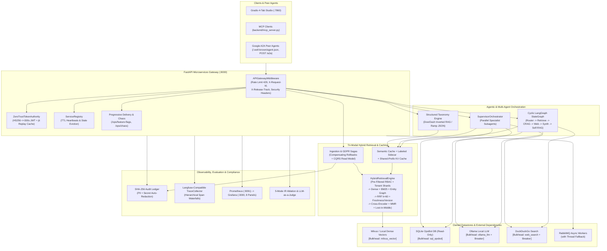
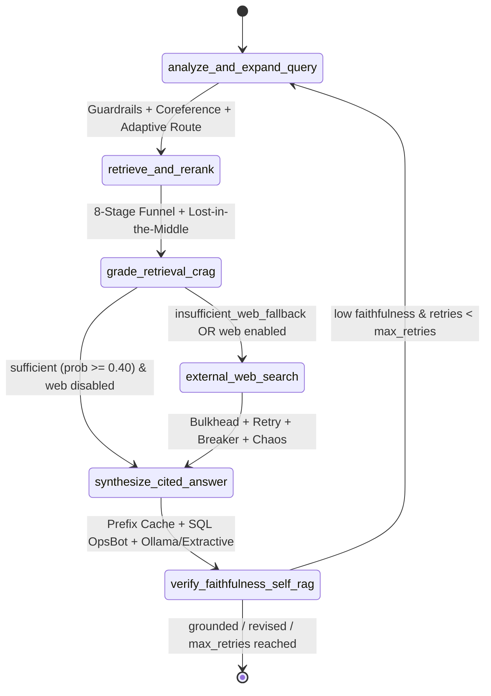

# Technical Architecture Plan & Module Blueprint

> **Spec-Kit Artifact:** `specs/001-staff-rag-platform/plan.md`
> **Companion Graphs:** Interactive AST knowledge graph in `graphify-out/graph.html` (`1,380` nodes, `2,554` edges, `103` communities).

---

## 1. End-to-End System Architecture

---

## 2. Cyclic LangGraph CRAG + Self-RAG Execution Flow

---

## 3. Complete Repository Module Blueprint

### Backend Application Packages (`backend/app/`) — All 14 Packages

| Package | Modules | Responsibility |
| :--- | :--- | :--- |
| `backend/app/a2a/` | `server.py` | Google A2A Agent Card (`/.well-known/agent.json`), JSON-RPC 2.0 (`tasks/send`, `tasks/get`, `tasks/cancel`), SSE (`tasks/sendSubscribe`), and Anti-Confused-Deputy `PEER_AGENT_ROLE_CEILINGS`. |
| `backend/app/agent/` | `graph.py`, `nodes.py`, `state.py`, `sql_tool.py`, `structured.py`, `subagents.py` | Cyclic LangGraph CRAG/Self-RAG pipeline (wired to bulkheads, retries & chaos), Agoda read-only SQLite OpsBot, DoorDash/Ramp structured taxonomy classifier, and 4-specialist parallel `SupervisorOrchestrator`. |
| `backend/app/data/` | `saga.py`, `cqrs.py` | `SagaOrchestrator`, `execute_ingestion_saga`, `execute_gdpr_erasure_saga` with reverse compensating transactions, `CQRSReadProjection` O(1) read snapshots, and `DATABASE_PER_SERVICE_BOUNDARIES`. |
| `backend/app/evaluation/` | `benchmark.py`, `metrics.py`, `judge.py` | Golden QA 5-mode IR ablation suite (`HitRate@K`, `MRR@K`, `NDCG@K`, `ContextPrecision@K`) and `RAGJudgeEvaluator` (Faithfulness, Relevance, Dropbox filename/citation hallucination audit, 4-case human calibration). |
| `backend/app/gateway/` | `discovery.py`, `middleware.py` | Dynamic `ServiceRegistry` (TTL heartbeats & stale-instance eviction) and `APIGatewayMiddleware` (per-client sliding-window `429 Retry-After` rate limiting, `X-Request-Id`, `X-Release-Track`, security headers). |
| `backend/app/guardrails/` | `security.py`, `audit.py` | OWASP LLM01/LLM02 PII & prompt-injection sanitizer plus `TamperEvidentAuditLogger` (SHA-256 hash chain with automatic PII and managed-secret redaction). |
| `backend/app/ingestion/` | `chunking.py`, `pdf_parser.py`, `pipeline.py` | Structure-aware Parent-Child chunking (tables, fenced code, Python AST + polyglot symbols, Anthropic contextual prefix, optional Ollama contextualizer), NVIDIA layout/table PDF parser, SHA-256 deduplication, and CDC upsert/delete orchestration. |
| `backend/app/memory/` | `conversation.py` | Session-scoped multi-turn conversational history and deterministic pronoun coreference resolution (`it`, `that`, `they` -> prior subject). |
| `backend/app/observability/` | `metrics.py`, `tracing.py`, `feedback.py` | Rolling `p50`/`p95`/`p99` latency & Prometheus exposition (including feedback, prefix cache & bulkhead gauges), `CircuitBreaker`, Langfuse-compatible `TraceCollector` with hierarchical ASCII span waterfalls, and Zendesk-style `FeedbackStore`. |
| `backend/app/resilience/` | `patterns.py`, `progressive_delivery.py`, `chaos.py` | `retry_with_backoff` (exponential backoff + jitter), `BulkheadPool` / `BulkheadRegistry`, `evaluate_degradation_level` (`L0–L3`), `FeatureFlagManager` (deterministic Canary `%` & Blue-Green track), and gated `ChaosController`. |
| `backend/app/retrieval/` | `embeddings.py`, `entity_graph.py`, `hybrid.py`, `labeled_queries.py`, `postprocessor.py`, `prefix_cache.py`, `reranker.py`, `semantic_cache.py`, `semantic_ids.py` | Thread-safe `ModelRegistry`, 1-hop Entity Knowledge Graph, Tri-Modal `HybridRetrievalEngine` (Pre-Filtered RBAC, Airbnb tenant shards, Spotify 4-level Semantic IDs, Perplexity Late Chunking, RRF `k=60`, freshness/version boost), calibrated Cross-Encoder, MMR + Lost-in-the-Middle postprocessor, Semantic/Labeled/Shared-Prefix caches. |
| `backend/app/security/` | `zero_trust.py` | Pure-stdlib HS256 `ZeroTrustTokenAuthority` (`ttl_sec <= 300s`, `iss`/`aud`/`exp` validation, `jti` replay cache) and least-privilege `SecretsProvider` with per-service allow-lists and `redact_secrets()`. |
| `backend/app/worker/` | `consumer.py` | RabbitMQ async query (`rag_jobs`) and ingestion (`rag_ingestion_jobs`) workers with automatic local thread-pool fallback when RabbitMQ is offline. |
| `backend/app/` (root modules) | `config.py`, `models.py` | Environment-backed `RAGSettings` and all 21 typed Pydantic v2 request/response/trace data contracts. |

### Top-Level Platform Directories

| Path | Purpose |
| :--- | :--- |
| `backend/main.py` | FastAPI gateway exposing 46 HTTP/SSE/JSON-RPC endpoints and mounting `APIGatewayMiddleware`. |
| `backend/mcp_server.py` | RBAC-scoped MCP server exposing 5 read/write/compliance tools with zero tool-poisoning surface. |
| `backend/debug.py` | CLI diagnostic runner for local corpus seeding, retrieval inspection, and 5-mode ablation benchmarks. |
| `backend/tests/` | Automated TDD, Security/OWASP, IR Ablation, Subagents, Google A2A, Microservices, Release Polish & Spec-Kit integrity test suite (`89` tests). |
| `frontend/app.py` | 4-Tab Gradio Studio (Ingestion/PDF/CDC, SSE & Multi-Agent Query Studio, 5-Mode Eval & Judge, Compliance Audit & P4 Microservices Ops). |
| `deploy/mesh/` | Istio `STRICT` mTLS `PeerAuthentication` and `DestinationRule` retry/outlier-detection traffic manifests. |
| `deploy/k8s/` | Immutable Kubernetes `Deployment` (`readOnlyRootFilesystem`, `runAsNonRoot`, digest-pinned), `Service`, `HPA`, `PDB`, and zero-trust `NetworkPolicy`. |
| `deploy/terraform/` | Immutable Terraform IaC skeleton managing cluster namespace, release-track ConfigMap, and digest pinning. |
| `observability/` | Prometheus scrape config (`prometheus.yml`) and pre-provisioned Grafana datasource & 8-panel dashboard (`rag_observability.json`). |
| `scripts/docker_stack_smoke_test.py` | Full-stack live integration smoke test verifying all 7 Docker Compose service endpoints end-to-end. |
| `.github/workflows/edd.yml` | GitHub Actions Eval-Driven Development gate running syntax checks, full pytest suite, and 5-mode IR regression assertions. |
